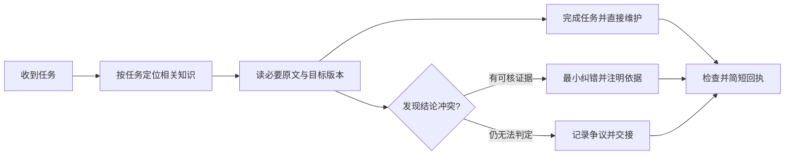

# Shared Agent Brain

一个让多个可信 Agent 共用、贡献和维护知识的轻量工作流。Obsidian / 普通 Markdown 均可使用，附独立 Skill。

[English](README.en.md) · [工作流](vault/00_Home/WORKFLOW.md) · [Skill](skills/shared-vault/SKILL.md) · [设计依据](docs/DESIGN.md)

**让知识跟着项目积累，让不同 Agent 可以接续；无需每次全读记忆，也无需固定经过某个 Agent 审批。**

## 现在能做什么

- 获准 Agent 直接维护自己负责的项目，也可有依据地补充共享知识。
- 按任务检索画像、经验和项目状态，展开相关原文；已读且未变的稳定上下文可复用。
- 保留他人的有效内容；已证实的错误直接修订，未决争议才走提案。
- 每个重要结论保留作者、来源、适用范围与事实/推断区分。
- 用户画像、项目状态、可复用经验分开记录；不把对话流水当长期记忆。

本仓库是规则、Skill 和空白模板，**不包含真实个人知识库，也不是自动记忆服务**。没有后台同步、跨会话自动缓存、向量检索或文件锁。

## 五分钟开始

### 方式一：Obsidian 或 Markdown

1. 下载仓库，**把 `vault/` 复制到公开仓库之外的私人目录**，用 Obsidian“打开文件夹作为仓库”打开它。普通编辑器也能使用。
2. 阅读 [START_HERE](vault/00_Home/START_HERE.md)。给 Agent 私人 Vault 的绝对路径，并明确允许它读取和维护哪些任务。
3. Agent 按需查看相关笔记，直接维护项目；重要修改后给简短记录回执。
4. 启动普通任务不必全文加载 PROFILE、LESSONS 和所有项目。涉及个人背景才查画像，选型或旧问题才查经验。

可直接对 Agent 说：

> 使用私人 Vault 的实际路径作为共享知识库。你可以直接维护本次任务和所属项目；先读它的 AGENTS.md 与必要上下文，遵守已有有效规则。普通修改无需另一个 Agent 审批。有依据时纠错，未核内容保持未核。最后告诉我记录了什么。

本仓库里的示例应保持虚构；不要在公开 checkout 中填写真实画像或聊天材料。

### 方式二：安装 Skill

把整个 `skills/shared-vault/` 文件夹复制到你的 Agent 支持的项目级技能目录，例如：

```text
your-workspace/.agents/skills/shared-vault/SKILL.md
```

这是文件式安装，不运行安装器、不改凭据或用户级设置。具体发现机制取决于 Agent；不支持 Skills 的工具可以直接读 SKILL.md。首次使用告诉它目标 Vault 路径：

> 使用 $shared-vault 接续这个项目。Vault 路径是我提供的私人目录。

Skill 可用于现有 Vault，不要求采用这里的英文目录名。它不授予原本不存在的文件接口或写入权限。

## 一次任务怎么流转



各项目由实际负责它的 Agent 维护。作者用于追溯，不是永久所有权。同一文件正在被修改时，协调串行或使用独立草稿/分支；文件哈希能检测版本变化，但不是锁。

## 目录

```text
vault/
  AGENTS.md
  00_Home/       入口、画像空表、工作流、记录边界
  01_Inbox/      待处理材料与争议入口
  02_Projects/   项目索引及虚构示例
  03_Areas/      长期领域入口
  04_Resources/  已验证经验入口
  90_Templates/  项目、纠错、争议模板
skills/shared-vault/
  SKILL.md
  agents/openai.yaml
```

## 示例

- “改一处标题”：读目标文件和适用规则，修改即可。
- “根据我的背景安排学习”：查相关画像及当前学习状态，再提出安排。
- “接手另一个 Agent 的项目”：读项目 CURRENT STATE、下一步和实际产物，不读整库。
- “发现旧结论错了”：核原证据与新证据，修订当前结论并留下简短修正说明。
- “两个来源冲突”：标成争议，不用 Agent 的多数赞同替代证据。

参见 [项目示例](vault/02_Projects/example-project.md) 和 [贡献说明](CONTRIBUTING.md)。

## 共享和发布

可信 Agent 的正常任务访问与公开发布分别处理。个人资料、凭据、原始聊天和无必要的第三方隐私不进入公开模板。医疗/重大财务事实按使用者自己的确认规则处理；Agent 推断不能升级为确诊或真实交易授权。

可以单机共享路径；跨电脑需要使用者提供的 Git、同步盘或文件接口。本项目不实现这些基础设施，也不保证同时编辑同一文件不会冲突。

## 状态与许可

初始版本：**v0.1.0**。已检查模板链接、Skill 结构和发布文件范围；未做跨模型效果、召回率或并发安全基准。

MIT License，见 [LICENSE](LICENSE)。欢迎通过 Issue 或 PR 改进通用工作流，请使用合成案例。
